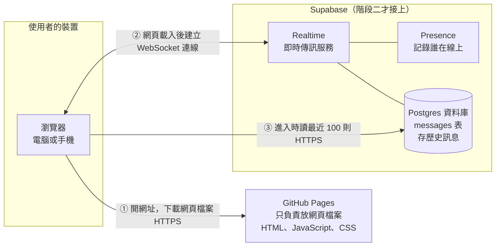
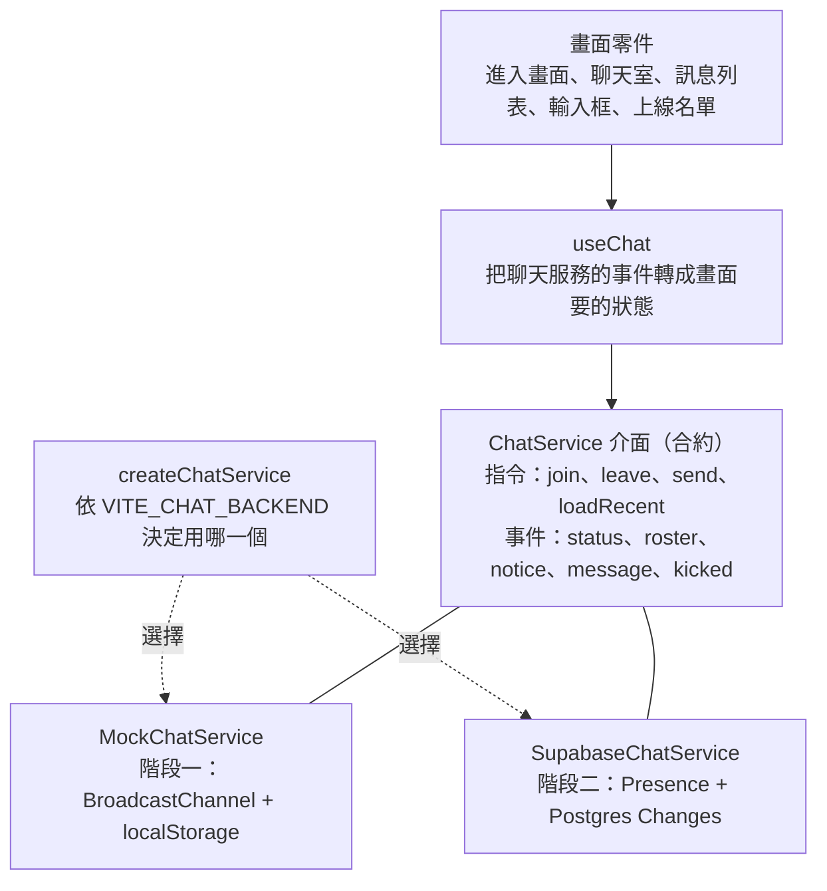
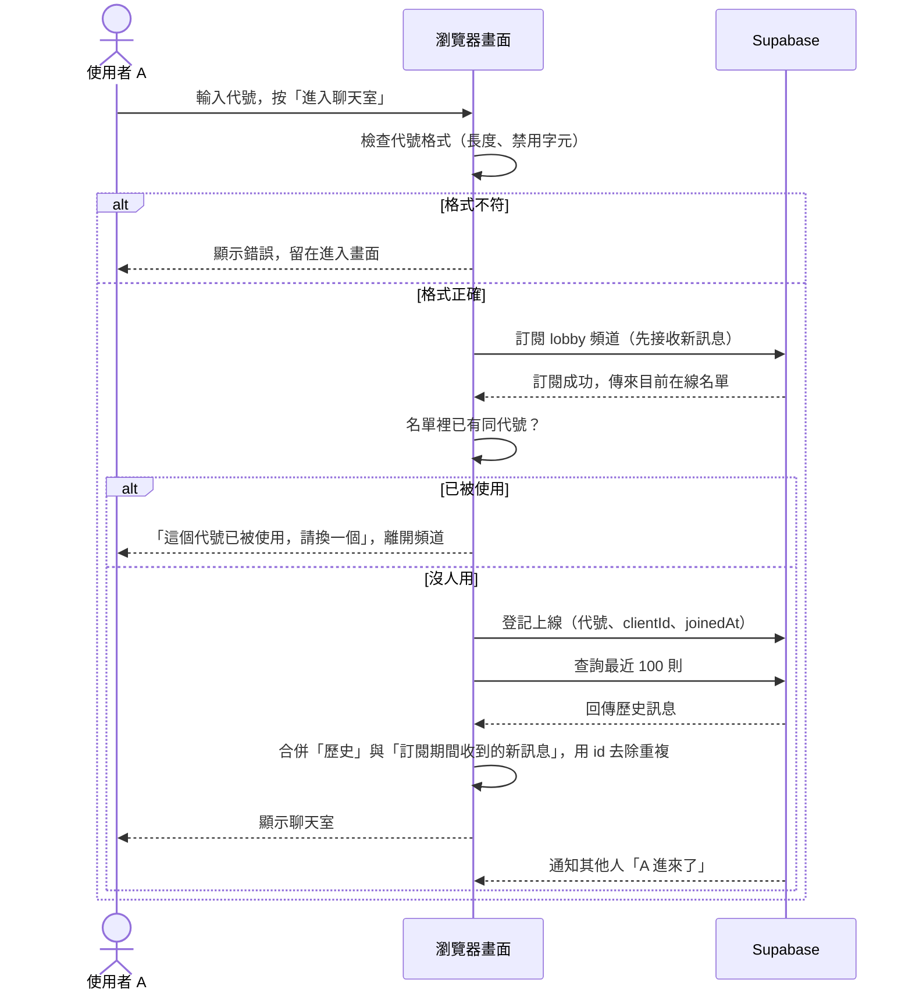
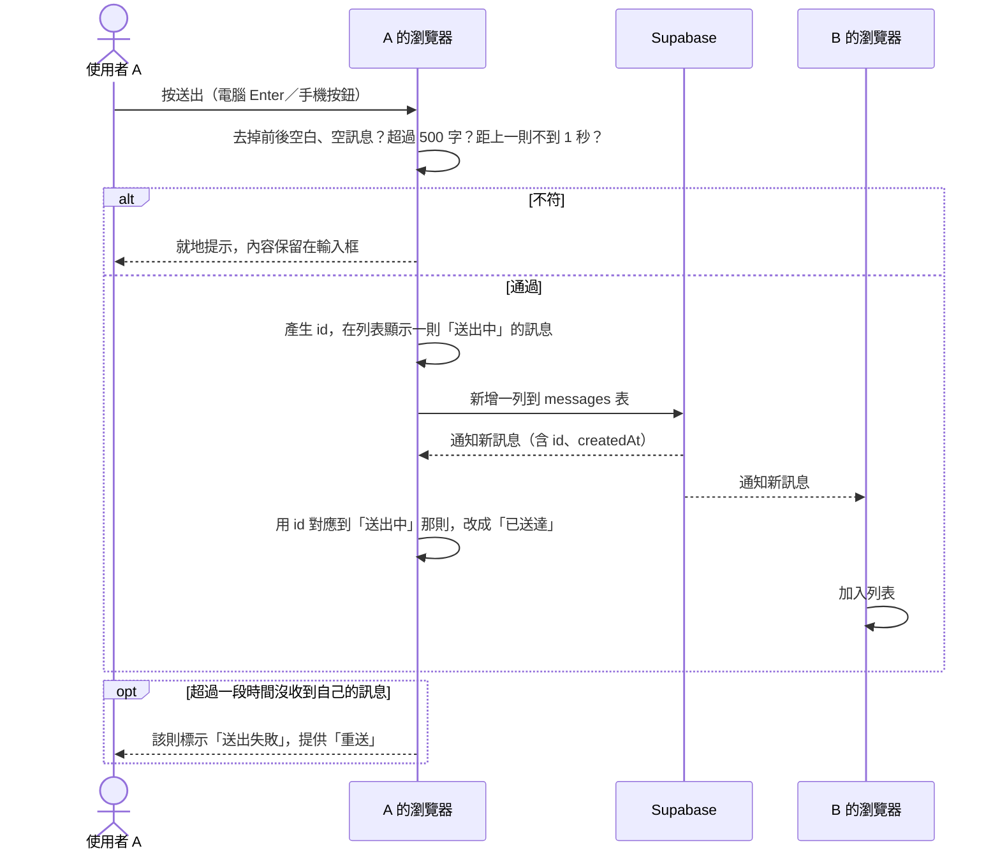
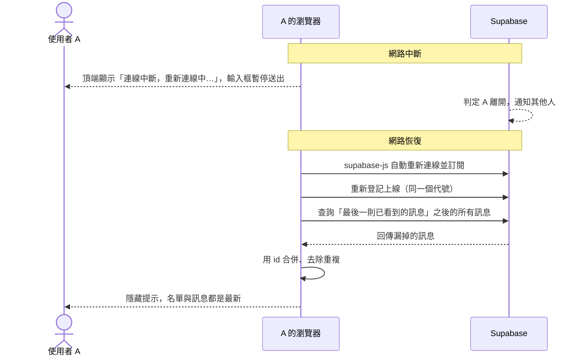

# 匿名聊天室：架構文件

文件日期：2026-10-13
對應需求：`docs/requirements.md`

這份文件說明要怎麼蓋這個聊天室。專有名詞第一次出現時，後面會用一句話解釋。文件裡沒有程式碼，只有決定和理由。

---

## 1. 專案說明與目標

一個不用登入的匿名聊天室。所有人在同一個聊天室裡，任何知道網址的人都能用電腦或手機進來。

使用流程：

1. 打開網頁。
2. 輸入一個代號。
3. 進入聊天室，看到其他人的訊息，也能送出訊息。

畫面上要看得到誰在線上，有人進來或離開時要有提示。

訪談後確定的行為（之後各段都以這些為準）：

| 項目 | 決定 |
|---|---|
| 歷史訊息 | 新進來的人先看到最近 100 則，之後即時更新 |
| 代號重複 | 目前在線上的人不能重複；有人離開後，代號就可以被別人用 |
| 代號長度 | 1–12 個字，前後空白自動去掉 |
| 重新整理 | 回到輸入代號畫面，欄位預先填好上次的代號，按一下才進入 |
| 訊息內容 | 純文字，上限 500 字，可換行，網址不會變成連結 |
| 送出方式 | 電腦：Enter 送出、Shift+Enter 換行。手機：Enter 換行，按按鈕送出 |
| 送訊息頻率 | 同一個人 1 秒內只能送一則 |
| 訊息保留 | 資料庫只保留最近一段時間，預設 7 天，超過的自動清掉 |

做事順序（來自需求文件）：

1. 先把前端做好，放上 GitHub Pages 看得到。
2. 最後才接上 Supabase。

---

## 2. 整體架構圖

名詞：

- **GitHub Pages**：GitHub 提供的免費網頁空間，只能放現成的網頁檔案，不能執行伺服器程式。
- **Supabase**：一個雲端服務，提供資料庫和即時傳訊功能，不用自己架伺服器。
- **WebSocket**：瀏覽器和伺服器之間一條保持開著的連線，伺服器有新訊息時可以主動推給瀏覽器，不用瀏覽器一直來問。



三者的分工：

- **GitHub Pages**：只在使用者打開網址時，把網頁檔案送到瀏覽器。聊天內容不經過它。
- **瀏覽器**：所有畫面和邏輯都在這裡執行。它同時連到 GitHub Pages（拿檔案）和 Supabase（聊天）。
- **Supabase**：負責即時傳訊、記錄誰在線上、存歷史訊息。

因為 GitHub Pages 不能執行伺服器程式，所以沒有「我們自己的後端」。瀏覽器直接跟 Supabase 說話，安全性靠 Supabase 資料庫上的規則（第 8、9 段）。

階段一沒有 Supabase 那一塊，瀏覽器自己模擬它（第 4 段）。

---

## 3. 技術選擇

每一項寫「選了什麼」和「為什麼」。

### 3.1 前端語言與框架

| 項目 | 選了什麼 | 為什麼 |
|---|---|---|
| 語言 | **TypeScript** | 是 JavaScript 加上「資料長什麼樣子」的標註。第 5 段的訊息格式會直接寫成標註，寫錯欄位名稱時編輯器會馬上報錯，不會等到上線才發現。 |
| 框架 | **React** | 框架是一套組畫面的現成工具。React 把畫面拆成獨立的小零件（訊息列表、輸入框、上線名單），每個零件可以單獨改。AI 工具對 React 最熟，後續請 AI 修改時比較不容易出錯。 |
| 建置工具 | **Vite** | 把我們寫的程式打包成瀏覽器能直接讀的檔案（這個動作叫「build」）。輸出是純靜態檔案，正好可以放 GitHub Pages。 |
| 樣式 | 一般 CSS 檔 | 不加 UI 套件。畫面設計由 `/design` 決定，`/frontend-design` 實作，用一般 CSS 最不會跟它們的產出衝突。 |
| 額外套件 | 只加 `@supabase/supabase-js` | 這是 Supabase 官方的瀏覽器工具包，階段二才用到。其他功能自己寫，套件越少，以後要升級的東西越少。 |

沒選的：

- **Next.js 這類需要伺服器的框架**：GitHub Pages 跑不了。
- **純 HTML 加 JavaScript、不用框架**：能做，但畫面有「進入畫面」「聊天室」兩個狀態，加上連線中、斷線、錯誤提示，檔案會變得很難維護。

### 3.2 Supabase 用哪些功能

| 需要的功能 | 用 Supabase 的哪個功能 | 為什麼 |
|---|---|---|
| 誰在線上、進出提示 | **Presence** | 每個連線的瀏覽器登記「我是誰」，Supabase 維護一份名單，有人加入、離開或斷線時通知所有人。這剛好是需求要的東西，不用自己寫。 |
| 即時收到新訊息 | **Postgres Changes** | 資料庫的 `messages` 表一多一列，Supabase 就透過 WebSocket 通知所有訂閱的人。 |
| 保存歷史訊息 | **Postgres 資料庫**（Supabase 內建的資料庫） | 新進來的人要看最近 100 則，需要把訊息存起來。 |
| 擋壞資料、擋亂改 | **Row Level Security（RLS，列級安全）** | 資料庫表格上的規則，規定誰可以讀、誰可以寫、寫的內容要符合什麼條件。 |
| 定期刪舊訊息 | **pg_cron**（資料庫的定時工作外掛） | 每天執行一次，刪掉超過保留期限的訊息。 |

不用的功能：Auth（登入）、Storage（檔案儲存）、Edge Functions（伺服器函式）。需求沒有登入，也沒有圖片或需要伺服器計算的東西。

**為什麼訊息走「資料庫寫入 + Postgres Changes」，而不是「Broadcast」（只轉發、不存檔的即時廣播）：**

- 需求要看得到最近 100 則，所以訊息一定要存進資料庫。
- 如果用 Broadcast，每則訊息要送兩次：一次存檔、一次廣播，兩邊可能不一致（存了但沒廣播，或廣播了但沒存到）。
- 用 Postgres Changes，寫入資料庫就是唯一的動作，其他人收到的通知就是來自這個寫入，歷史和即時永遠一致。
- Supabase 官方文件說，Postgres Changes 的負擔會隨訂閱人數增加，預期同時超過約 3,000 人訂閱同樣的變動時才建議改用 Broadcast。這個專案遠低於這個數字（免費方案連線上限 200，見第 9 段）。

---

## 4. 兩個階段

### 4.1 階段一：還沒接 Supabase

**目標**：把整個畫面和互動做完，放到 GitHub Pages 上，任何人打開網址都看得到、點得動。

**怎麼在沒有 Supabase 的情況下運作**：寫一個「模擬版」的聊天服務（mock，意思是假的、替身）。它用瀏覽器內建的兩個功能：

- **BroadcastChannel**：同一個瀏覽器的不同分頁之間互相傳話的功能。開兩個分頁，就像兩個人在聊天。
- **localStorage**：瀏覽器自己的小儲存空間，用來存歷史訊息和「上次用的代號」。

模擬版要遵守和真正的聊天室一樣的規則：代號不能重複（在不同分頁之間檢查）、1 秒一則、500 字上限、進來看到最近 100 則、進出提示、斷線提示（可以用開發者工具的離線模式測）。

**階段一做得到的**：

- 兩個畫面（第 7 段）全部能操作，電腦和手機版面都能看。
- 同一個瀏覽器開多個分頁，可以互相聊天、看到上線名單和進出提示。
- 所有錯誤提示（代號重複、太長、太快、斷線）都能觸發。
- 選用：網址加上 `?demo=1` 時，模擬版會放進幾個假的在線者，自己一個人測試時畫面不會是空的。

**階段一做不到的**：

- 不同裝置、不同人之間聊天。訊息只存在你自己的瀏覽器裡，手機和電腦看不到彼此。
- 真正的斷線重連。

所以階段一上線時，進入畫面和聊天室頂端要有一條固定提示：「展示模式：訊息只存在你的瀏覽器，別人看不到。」階段二接上後移除。

**怎麼在 GitHub Pages 上看到效果**：見第 12 段。階段一的建置設定是 `VITE_CHAT_BACKEND=mock`。

### 4.2 階段二：接上 Supabase 之後的改變

只改這幾件事：

| 改變 | 說明 |
|---|---|
| 新增 `SupabaseChatService` | 另一個聊天服務，用 Supabase 做和模擬版同樣的事 |
| 切換設定 | 建置設定從 `mock` 改成 `supabase` |
| 新增 `supabase/setup.sql` | 在 Supabase 後台建 `messages` 表、RLS 規則、定時清除的 SQL（資料庫指令） |
| 加上 Supabase 網址和公開金鑰 | 放在 GitHub 的設定裡（第 8、12 段） |
| 移除展示模式提示 | 一行設定 |

**畫面程式完全不改。**

### 4.3 兩階段之間，前端怎麼設計才不用重寫

做法：畫面不直接碰任何聊天的細節，它只對一個「聊天服務介面」說話。介面就是一份合約，規定有哪些指令可以下、會收到哪些事件。模擬版和 Supabase 版都照這份合約做，畫面不知道、也不需要知道背後是哪一個。



規則：

1. 只有 `createChatService` 這一個檔案知道有兩個版本。
2. 輸入驗證（代號、訊息長度、送出頻率）寫在獨立的 `validation` 檔案，兩個版本共用，所以規則只會有一份。
3. 錯誤用固定代碼回報（第 5 段），畫面只看代碼，不看底層錯誤訊息。
4. 階段一寫完時，要先把這份合約寫成文字（TypeScript 型別），階段二只需要照著實作。

---

## 5. 通訊約定

這一段是兩個階段共同遵守的合約。

### 5.1 資料格式

**訊息（Message）**

| 欄位 | 型別 | 說明 |
|---|---|---|
| `id` | 文字（UUID） | 由瀏覽器在送出時產生。收到伺服器回傳的同一個 `id`，就知道是自己那則已送達；歷史補抓時也靠它去除重複 |
| `nickname` | 文字，1–12 字 | 送出者的代號 |
| `content` | 文字，1–500 字 | 訊息內容 |
| `createdAt` | 時間（ISO 8601，UTC） | 階段二由資料庫填寫；階段一由模擬版填寫。顯示時轉成使用者本地時間，格式 `HH:mm` |

排序：先看 `createdAt`，相同時看 `id`。

**上線者（Presence 的登記資料）**

| 欄位 | 型別 | 說明 |
|---|---|---|
| `nickname` | 文字 | 代號 |
| `clientId` | 文字（UUID） | 每個瀏覽器分頁各自產生一個。用來判斷「兩個人搶同一個代號」時誰先誰後 |
| `joinedAt` | 時間 | 進入時間 |

階段二的 Presence 用 `nickname` 當 key（Supabase 用 key 區分不同的登記者）。聊天室只有一間，頻道名稱固定為 `lobby`。

### 5.2 指令（畫面對聊天服務下的）

| 指令 | 做什麼 | 失敗時的錯誤代碼 |
|---|---|---|
| `join(nickname)` | 用這個代號進入聊天室 | `NICKNAME_INVALID`、`NICKNAME_TAKEN`、`NOT_CONNECTED` |
| `leave()` | 離開聊天室 | 無 |
| `send(content)` | 送出一則訊息 | `MESSAGE_EMPTY`、`MESSAGE_TOO_LONG`、`RATE_LIMITED`、`NOT_CONNECTED`、`SEND_FAILED` |
| `loadRecent()` | 取得最近 100 則 | `NOT_CONNECTED`、`LOAD_FAILED` |

### 5.3 事件（聊天服務通知畫面的）

| 事件 | 內容 | 畫面怎麼處理 |
|---|---|---|
| `status` | `connecting`、`connected`、`reconnecting`、`offline` 其中之一 | 更新頂端連線狀態列 |
| `roster` | 目前所有在線者的完整名單 | 整份取代上線名單與人數 |
| `notice` | `kind`（`join` 或 `leave`）、`nickname`、時間 | 在訊息列表插入一行灰色提示。不存進歷史 |
| `message` | 一則 Message | 加入訊息列表（已存在的 `id` 就忽略） |
| `kicked` | `reason`（目前只有 `nickname-conflict`） | 回到進入畫面並顯示原因 |

### 5.4 階段二：這些事件怎麼對應到 Supabase

| 聊天服務的事件 | Supabase 的來源 |
|---|---|
| `roster` | Presence 的 `sync` 事件 |
| `notice` | Presence 的 `join`、`leave` 事件。第一次 `sync` 之前的、以及自己的，都忽略 |
| `message` | `messages` 表的 `INSERT` 事件（Postgres Changes） |
| `status` | 頻道訂閱狀態的變化（`SUBSCRIBED`、`CHANNEL_ERROR`、`CLOSED` 等） |
| `send` | 對 `messages` 表新增一列 |
| `loadRecent` | 查 `messages` 表，依 `createdAt` 由新到舊取 100 筆，再反過來排 |

Supabase 官方文件說明，Presence 的 `sync` 有時會在沒有人真正進出時也觸發（只是和伺服器對帳）。所以進出提示只能靠比對「前後兩份名單的差別」，不能每次 `join`、`leave` 都顯示。

### 5.5 `messages` 表（階段二）

| 欄位 | 型別 | 規則 |
|---|---|---|
| `id` | UUID | 主鍵（每列唯一的識別），由瀏覽器提供 |
| `nickname` | 文字 | 長度 1–12 |
| `content` | 文字 | 長度 1–500 |
| `created_at` | 時間 | 預設為寫入當下，瀏覽器不能指定 |

RLS 規則：

- 任何人可以讀取（`select`）。
- 任何人可以新增（`insert`），但內容必須通過上面的長度規則。
- 沒有任何人可以修改（`update`）或刪除（`delete`）。刪除只由定時工作以管理權限執行。

---

## 6. 資料流

下面的 A、B 是兩個不同的使用者。階段一把「Supabase」換成「模擬版」，流程相同。

### 6.1 進入聊天室



重點：

- **先訂閱、再查歷史**。如果反過來，在兩個動作之間送出的訊息會漏掉。用 `id` 去重，先訂閱就不會多也不會少。
- **同時搶同一個代號**：兩個人在同一瞬間檢查都看到沒人用，會同時登記。因此登記之後，每個人再檢查一次：同一個代號如果有兩筆以上的登記，`joinedAt` 較早的留下（相同時比較 `clientId`），其他人收到 `kicked`（`nickname-conflict`）。這個規則在每個瀏覽器上算出的結果一致，不需要伺服器裁決。
- **重新整理後被自己的舊連線擋住**：舊分頁剛關閉時，Supabase 可能還沒判定它已離開。遇到 `NICKNAME_TAKEN` 但代號正是自己上次用的那個，畫面顯示「正在確認舊連線是否已結束…」，自動重試幾次（預設 5 次，每次間隔 2 秒），仍被占用才顯示「代號已被使用」。

### 6.2 送出訊息



訊息是否送達，以「收到伺服器通知」為準，不是以「按下按鈕」為準。

### 6.3 離開

兩種情況：

| 情況 | 發生什麼 |
|---|---|
| 按「離開」 | 瀏覽器主動取消登記並關閉連線。其他人立即看到「A 離開了」。畫面回到進入畫面 |
| 直接關分頁／關瀏覽器 | 瀏覽器沒有機會通知。Supabase 偵測到連線中斷後，才判定 A 離開，其他人才看到提示。可能會晚一小段時間 |

### 6.4 斷線重連



注意：

- 斷線期間的進出提示不會補發，因為它們不存進資料庫。連回來後上線名單會整份刷新，所以名單是對的，只是少了那段時間的提示。
- 斷線期間別人用了你的代號：重新登記時會走 6.1 的流程，你會被告知代號已被使用並回到進入畫面。
- 重連失敗超過一段時間（預設 60 秒）：狀態改為 `offline`，提示變成「無法連線」，並提供「重新整理」按鈕。

---

## 7. 畫面清單

只寫元素與行為，不規定顏色、字體、版面風格。電腦和手機的差別只寫在需要的地方。

### 7.1 進入畫面

| 元素 | 行為 |
|---|---|
| 聊天室名稱與一行說明 | 純文字 |
| 展示模式提示（階段一才有） | 固定顯示：訊息只存在你的瀏覽器 |
| 代號輸入框 | 預先填入上次使用的代號（沒有就空白）。自動去掉前後空白。顯示目前字數 / 12。按 Enter 等同按「進入聊天室」 |
| 錯誤文字區 | 顯示格式錯誤、代號已被使用、被踢出的原因、無法連線。輸入內容時清除 |
| 「進入聊天室」按鈕 | 代號格式正確才可按。按下後變成「連線中…」並暫停再按 |

### 7.2 聊天室畫面

**頂端列**

| 元素 | 行為 |
|---|---|
| 聊天室名稱 | 純文字 |
| 在線人數 | 顯示「N 人在線」。電腦版上線名單固定顯示在側邊，所以這裡只是文字；手機版按它會打開上線名單 |
| 「離開」按鈕 | 按下後回到進入畫面。代號欄位維持預先填好 |

**連線狀態列**（只在不正常時出現）

| 狀態 | 顯示 |
|---|---|
| `connecting` | 連線中… |
| `reconnecting` | 連線中斷，重新連線中… |
| `offline` | 無法連線，附「重新整理」按鈕 |

**上線名單**

| 元素 | 行為 |
|---|---|
| 代號列表 | 顯示所有在線者，自己標示「（你）」。排序：自己在最上面，其他人依進入時間 |
| 電腦版 | 固定在側邊 |
| 手機版 | 從頂端列的人數按鈕打開，蓋在畫面上，有關閉按鈕，點外面也能關閉 |

**訊息列表**

| 元素 | 行為 |
|---|---|
| 一般訊息 | 顯示代號、時間（`HH:mm`）、內容。自己的靠右，別人的靠左。內容保留換行，長字串自動折行，不會撐破版面 |
| 自己的訊息狀態 | 「送出中」「已送達」「送出失敗」（附「重送」按鈕） |
| 系統提示 | 一行灰色小字，例如「小明 進來了」「小明 離開了」。不顯示時間以外的資訊，也不能被選取為訊息 |
| 歷史與即時的分界 | 開始時載入最近 100 則，如果不足 100 則就全部顯示。列表空白時顯示「還沒有訊息」 |
| 自動捲動 | 如果你停在最底部，新訊息進來會自動捲到底。如果你正在往上看舊訊息，不會被拉走，改為出現「有新訊息」按鈕，按下後捲到底 |

**輸入區**

| 元素 | 行為 |
|---|---|
| 文字輸入框 | 可多行。電腦：Enter 送出、Shift+Enter 換行。手機：Enter 換行。接近上限時（例如剩 50 字）才顯示「已輸入 / 500」，超過時禁止再輸入 |
| 「送出」按鈕 | 手機必有。內容為空、連線不正常時不可按。送出後輸入框清空並維持焦點（手機鍵盤不收起） |
| 錯誤提示 | 太快（「請稍等一下再送」）、太長、送出失敗。顯示在輸入框上方，幾秒後消失，輸入內容保留 |

### 7.3 其他狀態

| 狀態 | 畫面 |
|---|---|
| 被踢出（代號衝突） | 回到進入畫面，錯誤區寫明原因 |
| 載入歷史失敗 | 列表區顯示「無法載入歷史訊息」與「重試」按鈕，不影響即時收訊息 |

---

## 8. 金鑰

**金鑰（API key）**：一段長字串，像是程式連到某個服務時出示的通行證。不同金鑰有不同的權限。

### 8.1 這個專案用到什麼

| 名稱 | 用途 | 能公開嗎 | 本專案用嗎 |
|---|---|---|---|
| Project URL（`https://xxxx.supabase.co`） | 瀏覽器要連到哪個 Supabase 專案 | 可以 | 用 |
| **Publishable key**（`sb_publishable_…`） | 瀏覽器用的低權限金鑰。能做什麼，完全由資料庫的 RLS 規則決定 | **可以。** 它必然會出現在網頁原始碼裡，任何人打開瀏覽器都看得到 | 用 |
| 舊版 `anon` key | publishable key 的舊版 | 可以 | 不用。新專案用 publishable key，兩個不要混用 |
| **Secret key**（`sb_secret_…`）／舊版 `service_role` key | 高權限金鑰，**會略過所有 RLS 規則** | **絕對不行** | **不用。不需要產生，也不需要複製** |
| 資料庫密碼（建專案時設定的） | 直接連資料庫 | 絕對不行 | 不用。存在密碼管理工具就好 |
| Supabase 帳號密碼、Access token | 管理 Supabase 專案 | 絕對不行 | 不用 |

Supabase 官方文件對 secret key 的說明是：不要放進瀏覽器、已發布的應用程式或原始碼控管（也就是 Git）。

**這個專案不需要任何 secret key。** 建表、設規則、設定定時工作，都是你登入 Supabase 後台，在網頁的 SQL Editor（寫資料庫指令的視窗）裡貼上 `supabase/setup.sql` 執行，不經過任何金鑰。

### 8.2 怎麼產生、在哪裡找

階段二才需要：

1. 到 supabase.com 註冊並建立一個專案。
2. 在專案後台的 **Settings → API Keys**，可以看到 Project URL 與 Publishable key。後台右上角的 **Connect** 視窗也會把這兩個值列出來，可以直接複製。
3. 同一頁還會看到 secret key。**不要複製它。**

### 8.3 放在哪裡

| 位置 | 放什麼 | 會不會進 Git |
|---|---|---|
| 你電腦上的 `.env.local` | Project URL、Publishable key，只用於本機測試 | 不會（`.gitignore` 擋掉） |
| 專案裡的 `.env.example` | 同樣的欄位名稱，值留空 | 會，它只是範本，不含真實的值 |
| GitHub 的 repo 設定 → Secrets and variables → Actions → **Variables** 分頁 | `VITE_SUPABASE_URL`、`VITE_SUPABASE_PUBLISHABLE_KEY`、`VITE_CHAT_BACKEND` | 不會，存在 GitHub 上 |

因為 publishable key 本來就公開，放 Variables 或 Secrets 都可以。不管放哪裡，不要放 `sb_secret_…`。

欄位名稱以 `VITE_` 開頭是 Vite 的規定：只有這種開頭的設定值才會被打包進網頁。其他設定值不會進網頁，這樣如果不小心放了不該放的，至少不會自動被公開。

### 8.4 怎麼避免被 commit 到 GitHub

1. `.gitignore` 包含 `.env`、`.env.*`，但保留 `!.env.example`。
2. `.env.example` 只寫欄位名稱，不寫真實的值。
3. 每次 commit 前執行一次檢查：搜尋整個專案有沒有 `sb_secret_`、`service_role`、`eyJ`（舊版金鑰的開頭）。搜得到就不要 commit。
4. 在 GitHub 的 repo 設定 → Code security 開啟 secret scanning 和 push protection（掃描並擋下含金鑰的 push），它能擋掉常見格式的金鑰。
5. 如果 secret key 還是不小心 push 了：**當作已經外洩。** 到 Supabase 後台停用或重新產生這把金鑰。只刪掉 commit 不夠，因為 Git 保留歷史，GitHub 上的內容也可能已被別人複製。

---

## 9. 安全與限制

### 9.1 別人可以送什麼奇怪的東西進來

因為沒有登入，任何人都可以：

- 用任何工具（不只是我們的網頁）直接對資料庫送資料，因為 publishable key 是公開的。
- 同時開很多個分頁、用很多個代號。

所以規則分兩層：**前端擋**是為了讓一般使用者看到好的提示；**資料庫擋**（階段二）是為了擋掉繞過前端的人。前端的檢查可以被繞過，不能當作安全防線。

| 可能的輸入 | 風險 | 前端怎麼擋 | 資料庫的後盾（階段二） |
|---|---|---|---|
| 內容含 HTML 或程式，例如 `` | 在別人的瀏覽器執行（稱為 XSS，跨站腳本攻擊） | 一律當純文字顯示。React 預設就是這樣；專案內禁止使用 `dangerouslySetInnerHTML`（React 的「直接當 HTML 輸出」功能） | 無法擋，靠前端顯示方式 |
| 超長內容 | 撐爆版面、占用資料庫 | 超過 500 字不能送；長字串強制折行 | `content` 長度 1–500 的規則 |
| 超長代號 | 同上 | 超過 12 字不能進入 | `nickname` 長度 1–12 的規則 |
| 只有空白、或大量空行 | 洗版 | 去掉前後空白；連續空行只保留一行；空訊息不能送 | 長度規則 |
| 看不見的字元（零寬字元、控制字元） | 假裝成別人的代號、或看不出來的空訊息 | 代號與訊息拒絕這類字元 | 視需要加字元格式規則 |
| 反向文字控制字元 | 讓後面的文字反向顯示、擾亂版面 | 同上，拒絕 | 同上 |
| 假冒系統的代號（「系統」「system」） | 假裝成進出提示 | 保留這幾個代號，不能使用；系統提示的樣式和一般訊息明顯不同 | 無 |
| 長得很像的代號（全形和半形、大小寫） | 假冒別人 | 比對是否重複時，先統一成同一種寫法再比（Unicode 正規化加忽略大小寫） | 無 |
| 瘋狂快速送訊息 | 洗版、吃光免費額度 | 同一瀏覽器 1 秒一則 | 階段二加一個資料庫規則：同一代號 1 秒內不能新增第二則 |
| 開很多個代號 | 繞過上面的頻率限制 | 擋不住 | 擋不住（見 9.2） |
| 對資料庫亂改亂刪 | 竄改歷史 | 無 | RLS 沒有開放 `update`、`delete` |

### 9.2 擋不住的，需要接受的

- **有人可以冒用別人的代號送訊息。** 代號只是一個文字，沒有驗證。在線上的人我們能擋重複，但不在線上時，任何人都能用那個名字寫入資料庫。
- **有心人可以用腳本、多個代號洗版。** 影響上限是 Supabase 免費方案的每秒訊息數（見 9.3），超過時 Supabase 會拒絕，聊天室會變慢或暫時不能用，但不會造成資料外洩。
- 如果真的被濫用，最後的手段是在 Supabase 後台停用目前的 publishable key 再換新的（需要重新建置網站），或暫停整個專案。第一版不提供管理介面。

### 9.3 免費方案的上限

以下數字來自 Supabase 官方文件。

**Realtime（即時傳訊）**，來源：<https://supabase.com/docs/guides/realtime/limits>

| 項目 | 免費方案 |
|---|---|
| 同時連線數 | 200 |
| 每秒訊息數 | 100 |
| 每秒新加入頻道數 | 100 |
| 每個連線可加入的頻道數 | 100（我們只用 1 個） |
| 每秒 Presence 訊息數 | 20 |
| 單則 Broadcast 大小 | 256 KB（我們不使用 Broadcast） |

**資料庫**，來源：<https://supabase.com/docs/guides/platform/billing-on-supabase>

| 項目 | 免費方案 |
|---|---|
| 資料庫大小 | 每個專案 500 MB |
| 免費專案數 | 2 |

這對我們的影響：

- **同時最多約 200 人在線。** 第 201 個人連不上，需要在畫面顯示「聊天室目前人數已滿」之類的失敗提示（在現有的 `offline`／連線失敗提示中處理）。
- **Presence 每秒 20 則**：很多人在同一秒進出時會被限速。結果是名單更新慢一點，不是壞掉。
- **訊息每秒 100 則**：一般聊天遠低於這個數字。
- **資料庫 500 MB**：純文字訊息 500 字上限，加上 7 天清除，離上限很遠。清除工作的目的主要是控制隱私和資料量，不是為了救空間。
- **閒置會被暫停**：Supabase 免費專案太久沒人用會被暫停，之後要到後台手動恢復才能再連。多篇第三方整理寫的期限是一週，但官方帳務頁面沒有寫明天數，要確認請看 Supabase 後台的提示。預防方法：偶爾有人用，或自己定期登入開一次。
- 免費方案沒有自動備份。聊天內容不是重要資料，第一版不處理。

> 免費方案的數字會變動，開始階段二之前先看一次官方頁面。

---

## 10. 這一版刻意不做的事

| 不做 | 為什麼 |
|---|---|
| 登入、註冊 | 需求明說不要 |
| 代號保留／帳號 | 沒有登入就沒辦法證明「我是這個代號的主人」。代號只在你在線期間屬於你 |
| 圖片、檔案、貼圖 | 會牽涉儲存空間、費用與不當內容審查。第一版只處理文字 |
| 網址變成連結 | 避免有人貼惡意網址。純文字最單純 |
| 管理功能（刪訊息、封鎖、禁言） | 沒有登入，就沒有辦法區分誰是管理員。第一版靠頻率限制、長度限制和自動清除 |
| 多個聊天室、私訊 | 需求是「所有人在同一個聊天室」 |
| 「對方正在輸入」、已讀 | 增加即時訊息量，需求沒有要求 |
| 通知（聲音、瀏覽器推播） | 需求沒有要求，推播還需要額外的權限與設定 |
| 編輯、刪除自己的訊息 | 沒有登入，無法確認誰能改誰的訊息 |
| 搜尋歷史、無限往上捲 | 需求只要求最近 100 則 |
| 多語系介面 | 目前只有繁體中文 |
| 嚴格的伺服器端防洗版 | 沒有登入，無法辨識來源，要做就需要自己的伺服器。見 9.2 |
| 自己的後端伺服器 | GitHub Pages 不能跑伺服器程式。瀏覽器直接連 Supabase，靠 RLS 保護 |

---

## 11. repo 的資料夾結構

階段一的檔案以標記 `[1]` 表示，階段二新增的以 `[2]` 表示。

```
anonymous-chat/
├─ .github/
│  └─ workflows/
│     └─ deploy.yml            [1] 自動建置並發布到 GitHub Pages
├─ docs/
│  ├─ requirements.md          需求說明
│  └─ architecture.md          這份文件
├─ public/                     [1] 圖示等不需要處理的靜態檔案
├─ src/
│  ├─ main.tsx                 [1] 程式入口
│  ├─ App.tsx                  [1] 決定顯示進入畫面還是聊天室
│  ├─ screens/
│  │  ├─ JoinScreen.tsx        [1] 進入畫面
│  │  └─ ChatScreen.tsx        [1] 聊天室畫面
│  ├─ components/
│  │  ├─ TopBar.tsx            [1] 頂端列
│  │  ├─ ConnectionBanner.tsx  [1] 連線狀態列
│  │  ├─ OnlineList.tsx        [1] 上線名單
│  │  ├─ MessageList.tsx       [1] 訊息列表
│  │  ├─ MessageItem.tsx       [1] 單則訊息
│  │  ├─ SystemNotice.tsx      [1] 進出提示
│  │  ├─ Composer.tsx          [1] 輸入區
│  │  └─ DemoBanner.tsx        [1] 展示模式提示（階段二移除）
│  ├─ chat/
│  │  ├─ types.ts              [1] Message、事件、錯誤代碼的型別（第 5 段的合約）
│  │  ├─ ChatService.ts        [1] 聊天服務介面
│  │  ├─ validation.ts         [1] 代號與訊息的檢查規則（兩版共用）
│  │  ├─ MockChatService.ts    [1] 模擬版
│  │  ├─ SupabaseChatService.ts [2] Supabase 版
│  │  └─ createChatService.ts  [1] 依設定選擇使用哪一版
│  ├─ hooks/
│  │  └─ useChat.ts            [1] 把聊天服務的事件轉成畫面的狀態
│  └─ styles/                  [1] CSS 檔，內容由 /design 與 /frontend-design 決定
├─ supabase/
│  └─ setup.sql                [2] 建 messages 表、RLS 規則、定時清除
├─ .env.example                [1] 設定欄位範本，不含真實的值
├─ .gitignore                  [1] 擋掉 .env、node_modules、dist
├─ index.html                  [1]
├─ package.json                [1] 專案用到哪些套件
├─ tsconfig.json               [1]
├─ vite.config.ts              [1] 含網站路徑設定（第 12 段）
└─ README.md                   [1] 怎麼在本機跑起來、怎麼部署
```

`.env.local` 只存在你的電腦上，不在 repo 裡，所以沒有列出。

---

## 12. 部署到 GitHub Pages

**GitHub Actions**：GitHub 提供的自動化功能。你把程式推上去之後，它會自動執行一連串步驟（安裝套件、建置、發布）。

### 12.1 一次性設定

1. 在 GitHub 建立 repo。免費帳號要用 GitHub Pages，repo 必須是**公開**的；這個專案裡沒有任何不能公開的東西（第 8 段），所以可以公開。
2. 到 repo 的 **Settings → Pages**，把 **Source**（發布來源）改成 **GitHub Actions**。
3. `vite.config.ts` 的網站路徑（`base`）設成 `/<repo 名稱>/`。GitHub Pages 網址是 `https://<你的帳號>.github.io/<repo 名稱>/`，路徑不對的話，網頁會載不到 JavaScript，畫面一片空白。

### 12.2 每次發布

1. 把程式推到 `main` 分支。
2. `deploy.yml` 自動執行：下載程式 → 安裝套件 → 建置 → 把建置結果上傳 → 部署到 Pages。
3. 在 repo 的 **Actions** 分頁看執行結果，綠色勾勾表示成功。
4. 打開上面那個網址確認。

這個專案只有一個頁面，沒有網址分頁，所以不會遇到「重新整理後出現 404」的問題。

### 12.3 階段一與階段二的差別

| | 階段一 | 階段二 |
|---|---|---|
| `VITE_CHAT_BACKEND` | `mock` | `supabase` |
| `VITE_SUPABASE_URL` | 不需要 | 在 GitHub Variables 設定 |
| `VITE_SUPABASE_PUBLISHABLE_KEY` | 不需要 | 在 GitHub Variables 設定 |
| 改完設定後 | 無 | 再推一次程式，或到 Actions 手動重跑一次，讓網站用新設定重新建置 |

設定值是在**建置當下**被打包進網頁的。只改 GitHub 上的設定、不重新建置，網站不會改變。

---

## 13. 驗證清單

### 階段一（模擬版，放在 GitHub Pages）

**部署**

- [ ] Actions 執行成功，Pages 網址打得開，畫面不是空白。
- [ ] 重新整理網頁沒有出現 404。
- [ ] 進入畫面和聊天室頂端都有「展示模式」提示。

**進入**

- [ ] 第一次進來，代號欄位是空的。
- [ ] 代號空白、超過 12 字、含禁用字元、是「系統」，各自顯示正確的錯誤，且不能進入。
- [ ] 進入聊天室後重新整理：回到進入畫面，代號預先填好，需要按一下才進入。
- [ ] 開兩個分頁，第二個分頁用同一個代號：被擋下並顯示「已被使用」。關掉第一個分頁後，第二個分頁可以用那個代號。

**聊天**

- [ ] 兩個分頁用不同代號，互相能看到對方的訊息、對方出現在名單裡。
- [ ] 一個分頁進來或離開，另一個分頁出現進出提示，提示不算在歷史訊息裡。
- [ ] 重新整理後進來，看得到最近 100 則（先送超過 100 則測）。
- [ ] 訊息超過 500 字、空白訊息、1 秒內連送，都有正確的提示，輸入框內容不會消失。
- [ ] 電腦：Enter 送出、Shift+Enter 換行。手機（或手機模擬模式）：Enter 換行，按按鈕送出。
- [ ] 貼上 `<script>alert(1)</script>` 與 ``：原樣顯示為文字，沒有被執行。
- [ ] 貼上一長串沒有空白的字元：自動折行，版面沒有被撐開。
- [ ] 往上捲看舊訊息時，對方送新訊息：畫面沒有被拉走，出現「有新訊息」按鈕。

**版面**

- [ ] 電腦寬螢幕：上線名單在側邊。
- [ ] 窄螢幕（約手機寬度）：名單收起，從人數按鈕打開並可關閉。
- [ ] 手機上鍵盤跳出時，輸入框沒有被鍵盤蓋住。

**斷線**

- [ ] 用瀏覽器開發者工具切成離線：出現「連線中斷」提示，不能送出；恢復後提示消失。

### 階段二（接上 Supabase）

**設定與金鑰**

- [ ] 整個專案搜尋 `sb_secret_`、`service_role`、`eyJ`：沒有結果。
- [ ] GitHub 的 Variables 裡只有 Project URL 和 publishable key。
- [ ] 打開網站，查看網頁原始碼或網路請求：用到的只有 publishable key。
- [ ] `.env.local` 沒有出現在 `git status`。
- [ ] 展示模式提示已不見。

**資料庫規則**

- [ ] `messages` 表已開啟 RLS，只有讀取與新增規則。
- [ ] 用公開金鑰嘗試修改或刪除一則訊息：被拒絕。
- [ ] 用公開金鑰嘗試新增一則 501 字的訊息、或代號 13 字的訊息：被拒絕。
- [ ] 定時清除工作已建立，並且手動執行一次能刪掉超過期限的測試資料。

**多人聊天（用兩台不同的裝置，例如電腦和手機）**

- [ ] 兩台裝置互相看得到對方的訊息、名單、進出提示。
- [ ] 同一個代號：第二台被擋下。第一台離開後，第二台可以用。
- [ ] 兩台幾乎同時用同一個代號進入：最後只有一台留在聊天室，另一台收到「代號已被使用」。
- [ ] 一台關掉分頁，另一台看到離開提示（可能晚一點）。
- [ ] 重新整理後，代號預先填好，進來看得到最近 100 則。
- [ ] 一台把網路中斷再恢復：顯示重新連線，恢復後中斷期間漏掉的訊息補回來，且沒有重複。
- [ ] 重新整理後馬上用同一個代號進入，不會永久被自己的舊連線擋住（會自動重試）。
- [ ] 同一瀏覽器 1 秒內連送，被擋下；用資料庫規則測試同一代號 1 秒內新增兩則，第二則被拒絕。

**錯誤情況**

- [ ] 把網路關掉後打開網頁：顯示無法連線，而不是空白或一直轉圈。
- [ ] 歷史載入失敗時（可以用錯誤的資料表名稱模擬），有重試按鈕，即時訊息仍可收到。
- [ ] 確認免費方案上限數字沒有變動（第 9.3）。
